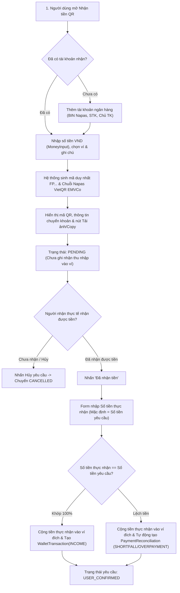

# ĐẶC TẢ TÍNH NĂNG: NHẬN TIỀN BẰNG QR, XÁC NHẬN THỦ CÔNG VÀ GHI NHẬN CHÊNH LỆCH

## 1. Bản chất nghiệp vụ & Tôn chỉ bảo mật

- **Không phải cổng thanh toán (Payment Gateway):** FlowPocket không giữ tiền của người dùng, không can thiệp luân chuyển tiền tệ, không yêu cầu OTP, mật khẩu Internet Banking hay mã PIN thẻ.
- **Tiêu chuẩn mã VietQR Napas EMVCo:** Sinh chuỗi mã QR chuyển khoản trực tiếp tuân theo đặc tả EMVCo QR Code Specification công khai của Napas Việt Nam (Point-of-Initiation 12, Napas GUID `A000000727`, mã BIN 6 số của ngân hàng Việt Nam, số tài khoản, số tiền VND và mã đối soát).
- **Offline & Riêng tư 100%:** Mã QR được mã hóa và vẽ trực tiếp trên trình duyệt bằng thư viện canvas nội bộ. Không gửi thông tin tài khoản qua bất kỳ API trung gian của bên thứ 3 nào.
- **Xác nhận thủ công:** Khoản tiền chỉ được cộng vào ví cá nhân khi người dùng tự xác nhận đã nhận được tiền ngoài đời thực. Hệ thống nêu rõ đây là xác nhận của người dùng (`USER_CONFIRMED`), không phải biến động số dư tự động từ ngân hàng (`bank_verified`).

---

## 2. Mô hình dữ liệu (Database Schema)

### 2.1. `receiving_accounts` (Tài khoản ngân hàng nhận tiền)
- `id`: UUID (Primary Key)
- `user_id`: UUID (Foreign Key -> `app_users.id`, ondelete="CASCADE")
- `bank_code`: VARCHAR(20) (Mã ngân hàng: VCB, MB, TCB, ACB, VPB, TPB...)
- `bank_name`: VARCHAR(100) (Tên ngân hàng)
- `account_number`: VARCHAR(50) (Số tài khoản)
- `account_holder_name`: VARCHAR(100) (Tên chủ tài khoản, in hoa chuẩn hóa)
- `display_name`: VARCHAR(100) (Tên gợi nhớ: "TK Lương", "MB Chính")
- `linked_wallet_id`: UUID (Foreign Key -> `wallets.id`, ondelete="SET NULL")
- `is_default`: BOOLEAN (Tài khoản nhận mặc định)
- `is_active`: BOOLEAN (Trạng thái hoạt động, hỗ trợ soft-delete khi đã có request lịch sử)
- `created_at`, `updated_at`: TIMESTAMP WITH TIME ZONE

### 2.2. `incoming_payment_requests` (Yêu cầu nhận tiền bằng QR)
- `id`: UUID (Primary Key)
- `user_id`: UUID (Foreign Key -> `app_users.id`, ondelete="CASCADE")
- `receiving_account_id`: UUID (Foreign Key -> `receiving_accounts.id`, ondelete="RESTRICT")
- `target_wallet_id`: UUID (Foreign Key -> `wallets.id`, ondelete="RESTRICT")
- `reference_code`: VARCHAR(32) UNIQUE (Mã tham chiếu: vd `FP261015ABCD`)
- `expected_amount`: BIGINT (Số tiền yêu cầu VND > 0)
- `actual_amount`: BIGINT NULL (Số tiền thực tế nhận được)
- `category_id`: UUID NULL (Foreign Key -> `categories.id`, ondelete="SET NULL")
- `description`: VARCHAR(255) NULL (Ghi chú nội bộ người dùng)
- `transfer_memo`: VARCHAR(50) (Nội dung chuyển khoản chuẩn hóa không dấu)
- `qr_payload`: TEXT (Chuỗi TLV chuẩn EMVCo hoàn chỉnh có CRC16)
- `status`: VARCHAR(30) (`PENDING`, `USER_CONFIRMED`, `CANCELLED`, `EXPIRED`)
- `bank_code_snapshot`, `bank_name_snapshot`, `account_number_snapshot`, `account_holder_snapshot`: Lưu snapshot ngân hàng tại thời điểm phát hành yêu cầu.
- `confirmed_at`, `cancelled_at`: TIMESTAMP WITH TIME ZONE

### 2.3. `payment_reconciliations` (Bản ghi chênh lệch & đối soát)
- `id`: UUID (Primary Key)
- `user_id`: UUID (Foreign Key -> `app_users.id`, ondelete="CASCADE")
- `payment_request_id`: UUID UNIQUE (Foreign Key -> `incoming_payment_requests.id`, ondelete="CASCADE")
- `expected_amount`: BIGINT (Số tiền yêu cầu)
- `actual_amount`: BIGINT (Số tiền thực nhận)
- `difference_amount`: BIGINT (`actual_amount - expected_amount`)
- `difference_type`: VARCHAR(30) (`SHORTFALL` - Thiếu, `OVERPAYMENT` - Thừa)
- `status`: VARCHAR(30) (`OPEN`, `REVIEWED`, `RESOLVED`, `IGNORED`)
- `notes`: TEXT NULL (Ghi chú giải trình chênh lệch)
- `resolved_at`: TIMESTAMP WITH TIME ZONE NULL

---

## 3. Luồng hoạt động & Quy tắc nghiệp vụ

---

## 4. API Endpoints

| Phương thức | Endpoint | Chức năng | Yêu cầu CSRF |
| :--- | :--- | :--- | :---: |
| `GET` | `/api/v1/qr-payments/banks` | Lấy danh sách 22+ ngân hàng Việt Nam hỗ trợ VietQR | Không |
| `GET` | `/api/v1/qr-payments/receiving-accounts` | Danh sách tài khoản ngân hàng của user | Không |
| `POST` | `/api/v1/qr-payments/receiving-accounts` | Thêm tài khoản ngân hàng nhận tiền mới | Có |
| `GET` | `/api/v1/qr-payments/receiving-accounts/{id}` | Xem chi tiết 1 tài khoản | Không |
| `PUT` | `/api/v1/qr-payments/receiving-accounts/{id}` | Cập nhật tên gợi nhớ, ví liên kết, mặc định | Có |
| `DELETE`| `/api/v1/qr-payments/receiving-accounts/{id}` | Xóa tài khoản (soft-delete nếu đã có request) | Có |
| `POST` | `/api/v1/qr-payments/requests` | Tạo yêu cầu nhận tiền & sinh chuỗi VietQR TLV | Có |
| `GET` | `/api/v1/qr-payments/requests` | Danh sách yêu cầu (lọc `status`, phân trang) | Không |
| `GET` | `/api/v1/qr-payments/requests/{id}` | Xem chi tiết yêu cầu, chuỗi QR và đối soát | Không |
| `POST` | `/api/v1/qr-payments/requests/{id}/cancel` | Hủy yêu cầu đang chờ (`PENDING`) | Có |
| `POST` | `/api/v1/qr-payments/requests/{id}/confirm`| Xác nhận thực nhận, ghi sổ ví & tạo chênh lệch | Có |
| `GET` | `/api/v1/qr-payments/reconciliations` | Danh sách bản ghi chênh lệch | Không |
| `PUT` | `/api/v1/qr-payments/reconciliations/{id}` | Cập nhật trạng thái chênh lệch (`RESOLVED`) | Có |
| `POST`| `/api/v1/qr-payments/parse` | Bóc tách chuỗi VietQR thành STK, ngân hàng, số tiền, memo | Không |

---

## 5. Tính năng Quét mã QR Chi tiền & Chuyển tiền (QR Scanner)

- **Hỗ trợ 2 phương thức quét:**
  1. **Quét bằng Camera trực tiếp (Live Camera):** Sử dụng camera thiết bị với khung ngắm quét laser chuyển động nhận diện mã tức thì.
  2. **Tải ảnh mã QR từ thiết bị:** Đọc ảnh bill chuyển khoản, ảnh chụp màn hình Zalo/Messenger/Telegram từ thư viện.
- **Tự động bóc tách (Decode VietQR):** Nhận diện chính xác Ngân hàng thụ hưởng, Số tài khoản, Số tiền VND và Nội dung chuyển khoản.
- **Ghi nhận chi tiêu nhanh (Record Expense):**
  - Tự động điền số tiền và mô tả giao dịch.
  - Cho phép chọn ví chi tiền và danh mục chi tiêu.
  - Bấm lưu là tiền tự động được trừ khỏi ví cá nhân trong FlowPocket.

